# Brasileirão Theme

Português | [English](README.md)

[](https://code.visualstudio.com/)
[](https://marketplace.visualstudio.com/items?itemName=lucasnicolau30.brasileirao-theme)

[](LICENSE)

Um tema escuro e um tema de ícones para cada um dos 12 grandes do Brasileirão. A base é a mesma em todos (fundo escuro, texto claro, sintaxe discreta). Muda a identidade do time: a cor aparece na linha ativa, no número da linha, nas guias de indentação, nos pares de colchetes, nas réguas, na aba ativa, no cursor, na seleção e na barra de status — e, atrás do código, uma silhueta branca e discreta do escudo do clube.

> Projeto independente. Sem ligação com nenhum clube de futebol, com a CBF ou com o Brasileirão. Os nomes e os escudos dos clubes são marcas dos respectivos donos. Veja [Créditos e licenças](#créditos-e-licenças).

Times: Flamengo, Fluminense, Botafogo, Vasco, Corinthians, Palmeiras, São Paulo, Santos, Cruzeiro, Atlético-MG, Grêmio e Internacional.

## O que você recebe

- **Um tema de cores por clube**, com o contraste checado em todos (texto do editor com 7:1 ou mais; comentários, números de linha, barra de status, botões e níveis de colchete com 4,5:1 ou mais).
- **Um tema de ícones por clube**: o escudo do clube no lugar do ícone de pasta. Os ícones de arquivo vêm do Material Icon Theme.
- **O escudo atrás do código**: uma silhueta branca e fosca no fundo do editor, com as áreas claras vazadas para os detalhes aparecerem.
- **Uma seção "Títulos" no explorador**: os troféus da Copa do Brasil, da Libertadores e do Brasileirão, cada um com o número de títulos. Passe o mouse num troféu para ver os anos.
- **Um seletor de times com escudos**, pela barra de status ou pela paleta de comandos.
- **O Indent Rainbow nas cores do clube**, se você usa essa extensão.

## Capturas de tela

| Clube | Captura |
| --- | --- |
| Flamengo | 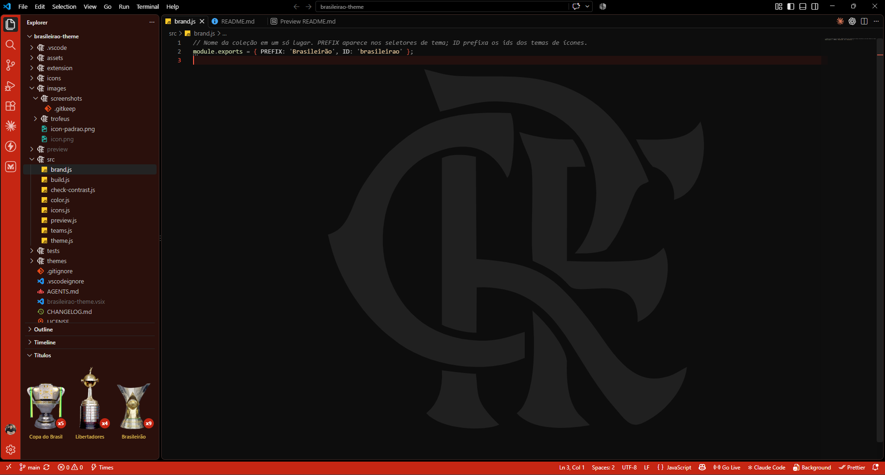 |
| Fluminense | 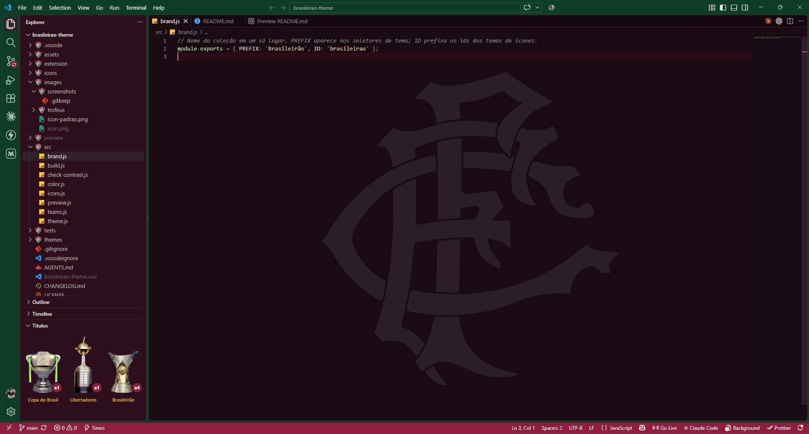 |
| Botafogo | 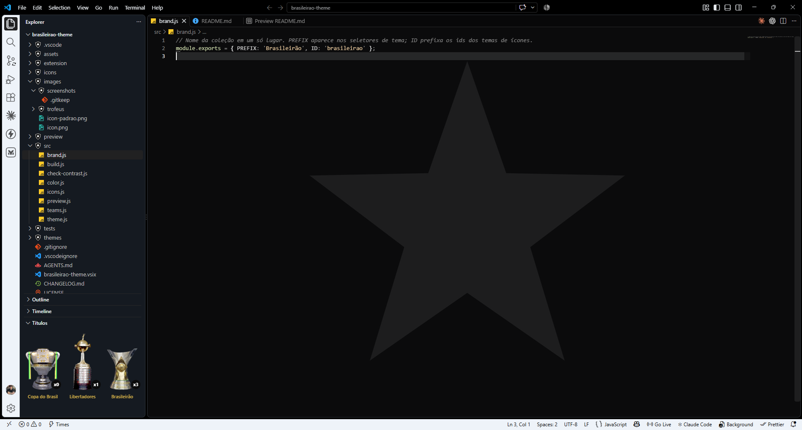 |
| Vasco | 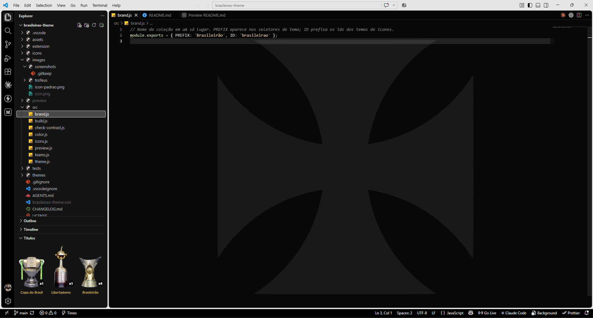 |
| Corinthians | 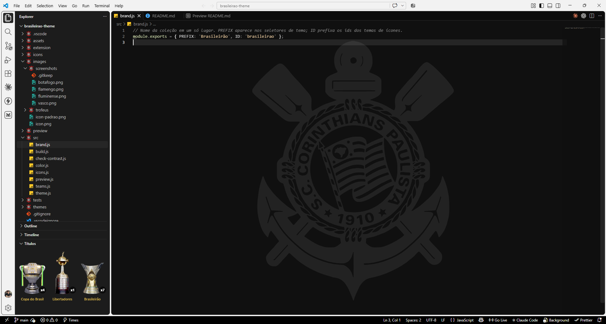 |
| Palmeiras | 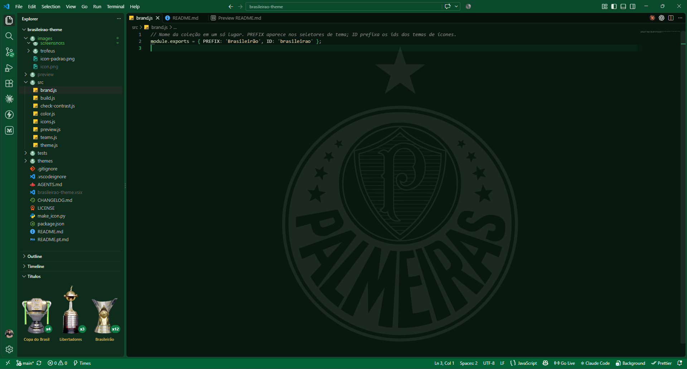 |
| São Paulo | 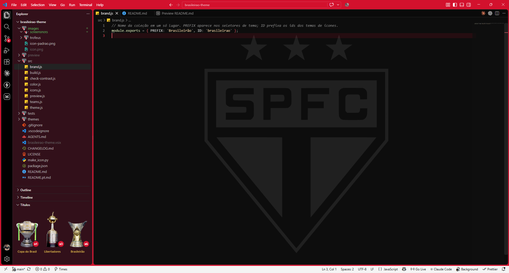 |
| Santos | 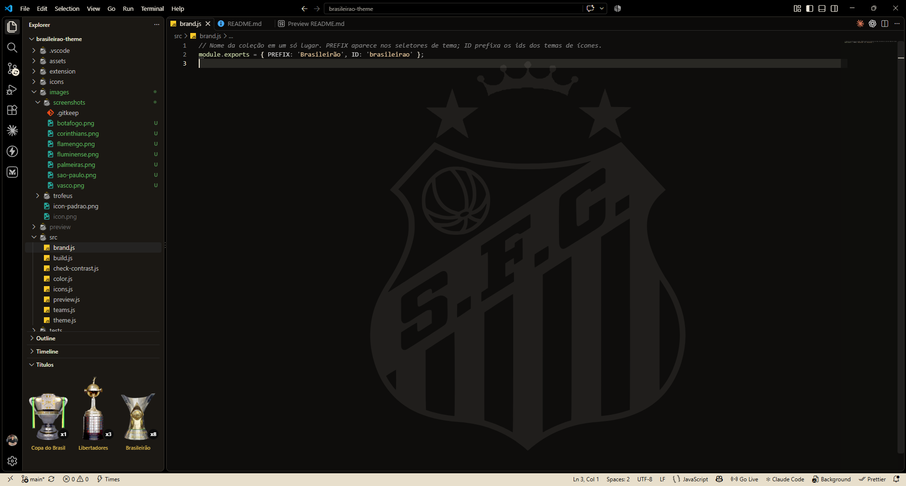 |
| Cruzeiro | 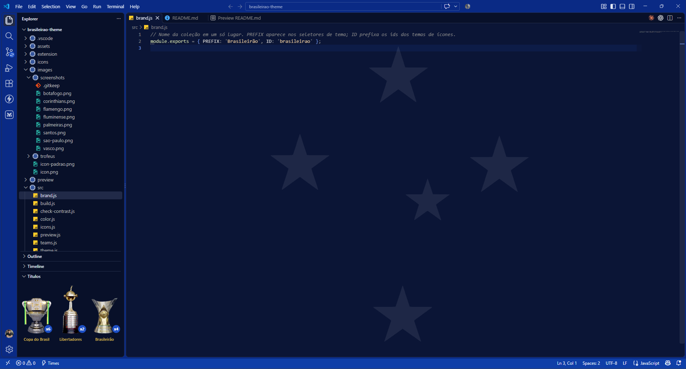 |
| Atlético-MG | 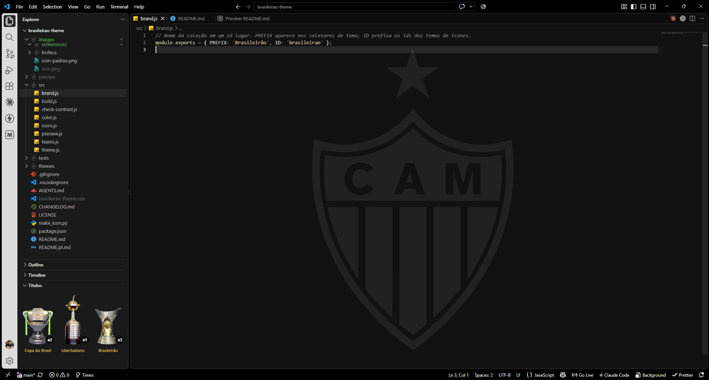 |
| Grêmio | 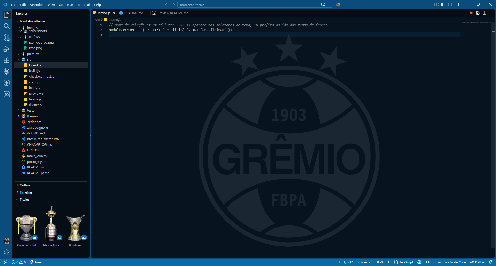 |
| Internacional | 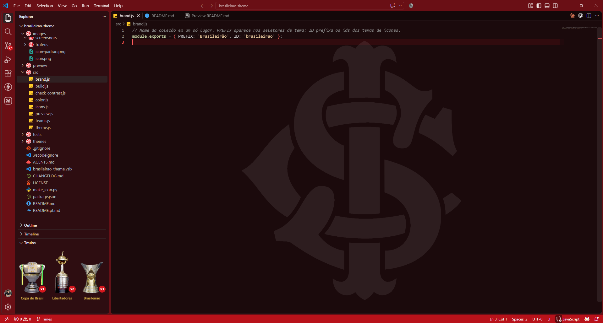 |

## Instalação

Procure por **Brasileirão Theme** na aba de extensões, ou:

```bash
code --install-extension lucasnicolau30.brasileirao-theme
```

Requer o VS Code 1.80 ou mais novo. O escudo no fundo do editor precisa também da extensão **Background** (veja [Escudo no fundo do editor](#escudo-no-fundo-do-editor)); o resto funciona sem ela.

## Como escolher o time

Escolha o time de um destes jeitos:

- **Botão "Times" na barra de status** (canto inferior esquerdo) ou **`Ctrl+Shift+P` e "Brasileirão: Escolher time"**: lista os 12 times com o escudo de cada um, as cores e o atual já selecionado. É o jeito recomendado.
- **`Ctrl+K Ctrl+T`**: o seletor de temas do VS Code, com os temas `Brasileirão: <time>` no meio dos outros.
- Evite os botões **Set Color Theme** e **Set File Icon Theme** da página da extensão. São do próprio VS Code (um para cada tipo de tema, e não dá para removê-los): a lista abre em ordem alfabética, sem marcar o tema atual, e já mostra uma prévia do primeiro item.

O VS Code não liga um tema de cores a um de ícones. Quem faz isso é um pouco de código da extensão: ao detectar um tema `Brasileirão: <time>`, ela grava o `workbench.iconTheme` correspondente nas configurações do usuário. Ao sair da coleção, devolve o tema de ícones que existia antes (se você escolher outro à mão, ela respeita). Para desligar, ponha `"brasileirao.syncIconTheme": false`.

## Escudo no fundo do editor

O VS Code não tem API para pôr imagem atrás do código. Por isso a extensão usa a extensão **Background** (`shalldie.background`), que altera um arquivo do próprio VS Code. Consequências, todas esperadas:

- O VS Code pede para **reiniciar** quando você escolhe um time (e na primeira vez que o escudo é aplicado). Na primeira vez, a extensão explica isso numa mensagem.
- Em algumas versões aparece o aviso de que a instalação está **"corrompida"**. A Background tenta escondê-lo, mas ele pode aparecer. Não há nada quebrado.
- Uma **atualização do VS Code** apaga a alteração; a extensão reaplica na próxima abertura.
- Para **não usar o escudo de fundo**, desligue `brasileirao.crestBackground`. Isso devolve o que estava antes. Os temas, os ícones e a seção "Títulos" continuam funcionando sem a Background.

Todos os escudos têm a mesma altura total (80% da janela), estrelas e coroa incluídas. Alguns mostram só o essencial do escudo: o monograma no Flamengo, no Fluminense e no Internacional, a estrela solitária no Botafogo, as cinco estrelas do Cruzeiro do Sul no Cruzeiro e a cruz de malta no Vasco.

## Títulos

A seção **Títulos**, no fim do explorador, mostra os troféus da Copa do Brasil, da Libertadores (no meio, maior) e do Brasileirão. Cada um tem uma bolinha na cor do clube com o número de títulos ("x9"). Passar o mouse num troféu mostra os anos.

Os dados ficam no campo `titles` de `src/teams.js`, até a temporada 2025. O Brasileirão segue o critério unificado da CBF (1959 em diante, mais o de 1937 do Atlético-MG); o Flamengo conta também 1987. Os testes conferem os anos contra uma tabela feita à mão.

## Paletas

| Time | Cor principal | Destaque no texto | Barra de status |
|---|---|---|---|
| Flamengo | `#c52613` | `#ff5a45` | `#c52613` |
| Fluminense | `#8f1d3d` | `#ec7898` | `#8f1d3d` |
| Botafogo | `#eef3f9` | `#ffffff` | `#eef3f9` |
| Vasco | `#e0e0e0` | `#f0f0f0` | `#000000` |
| Corinthians | `#bdbdbd` | `#ffffff` | `#2b2b2b` |
| Palmeiras | `#0b7a43` | `#3ccf8a` | `#006437` |
| São Paulo | `#d3112d` | `#ff5c6c` | `#000000` |
| Santos | `#f3ead8` | `#f6eedc` | `#e8dfcc` |
| Cruzeiro | `#1d4fc4` | `#7aa2ff` | `#0f3fa8` |
| Atlético-MG | `#d0d0d0` | `#f5f5f5` | `#1c1c1c` |
| Grêmio | `#0b76b0` | `#4db8f5` | `#0a6aa3` |
| Internacional | `#d4161c` | `#ff5d5d` | `#b8121a` |

A cor oficial do clube nem sempre serve como texto sobre fundo escuro (os azuis, por exemplo, ficam apagados). Por isso cada time tem a cor principal, usada em áreas preenchidas, e uma versão mais clara para texto.

Cinco clubes são preto e branco (Botafogo, Vasco, Corinthians, Santos e Atlético-MG). Eles se diferenciam por detalhes sutis: o tom do fundo e do branco (frio ou quente), a barra de status clara ou escura e a borda. Nesses temas os seis níveis de colchete alternam três tons, em vez de seis cores.

O terminal e o painel inferior usam a mesma cor da lateral do explorador.

## Indent Rainbow

Se você usa o **Indent Rainbow** (`oderwat.indent-rainbow`), ele pinta a indentação com amarelo, verde, rosa e azul, o que briga com as cores do time. Um tema não consegue mudar a configuração de outra extensão, então a Brasileirão Theme faz isso com um pouco de código: ao ativar um tema `Brasileirão: <time>`, ela troca `indentRainbow.colors` (nas configurações do usuário) por quatro cores do time, a 8% de opacidade. Ao escolher um tema que não é da coleção, devolve o valor que estava antes. Sem o Indent Rainbow instalado, nada acontece.

## Ícones de arquivo

Se o Material Icon Theme estiver instalado na máquina que gera o pacote, o tema de ícones do time usa os ícones de arquivo dele (centenas de tipos) e troca **todas** as pastas pelo escudo do time. O Material é MIT, e a licença vai junto em `icons/_material/LICENSE.txt`. Sem o Material, o build usa 18 ícones próprios (JavaScript, TypeScript, JSX, TSX, JSON, `package.json`, HTML, CSS, Markdown, Python, Java, C#, SQL, YAML, shell, imagens, texto, arquivos de configuração e as pastas `node_modules` e `.git`).

## Configurações

| Configuração | Padrão | O que faz |
| --- | --- | --- |
| `brasileirao.syncIconTheme` | `true` | Ao escolher um tema `Brasileirão: <time>`, troca também para o tema de ícones do mesmo time. |
| `brasileirao.crestBackground` | `true` | Mostra o escudo no fundo do editor. Precisa da extensão Background. Ao desligar, devolve a configuração anterior. |
| `brasileirao.crestOpacity` | `0.08` | Opacidade do escudo de fundo (0,01 a 0,3). |

## Desenvolvimento

```bash
npm run build      # gera temas, ícones e o bloco contributes do package.json
npm run check      # confere os contrastes mínimos nos 12 temas
npm test           # testes dos dados, dos arquivos gerados e do contraste (node --test)
npm run package    # build + check + brasileirao-theme.vsix
npm run instalar   # package + instala no VS Code (depois, recarregue a janela)
npm run preview    # gera preview/index.html com os 12 times lado a lado
```

A tabela de times é `src/teams.js`. Para mudar uma cor, o rótulo ou os títulos de um time, edite lá e rode `npm run build`. Os arquivos em `themes/` e `icons/` são gerados e não devem ser editados à mão.

Para testar sem instalar, abra esta pasta no VS Code e aperte `F5`.

### Imagens dos escudos

Os escudos são marca registrada dos clubes. As fontes ficam em `assets/escudos/` (e em `assets/escudos/fundo/`, as silhuetas do fundo do editor) e estão no `.gitignore`, então não sobem para o repositório. O `npm run build` usa as que existirem; sem o arquivo, a pasta usa a cor do time.

## Créditos e licenças

O código deste projeto está sob a [Licença MIT](LICENSE). Material de terceiros e como é usado:

### Software

| O quê | Autor | Licença | Como é usado |
| --- | --- | --- | --- |
| [Material Icon Theme](https://github.com/material-extensions/vscode-material-icon-theme) | Philipp Kief | MIT | Ícones de arquivo, embutidos em `icons/_material/` com a licença. |
| [Background](https://github.com/shalldie/vscode-background) | shalldie | MIT | Não vem junto. Necessária só para o escudo no fundo do editor. |
| [Indent Rainbow](https://github.com/oderwat/vscode-indent-rainbow) | oderwat | MIT | Não vem junto. Só a configuração de cores dele é alterada, se estiver instalado. |

### Fotos dos troféus

Recortadas do fundo e redimensionadas, via Wikimedia Commons.

| Troféu | Obra | Autor | Licença |
| --- | --- | --- | --- |
| Brasileirão | [Troféu Campeonato Brasileiro 2024.jpg](https://commons.wikimedia.org/wiki/File:Trof%C3%A9u_Campeonato_Brasileiro_2024.jpg) | Phill ad | [CC BY 4.0](https://creativecommons.org/licenses/by/4.0) |
| Libertadores | [328-3287452 copa-libertadores-primer-trofeo-hd-png-download.png](https://commons.wikimedia.org/wiki/File:328-3287452_copa-libertadores-primer-trofeo-hd-png-download.png) | Mathiaseditorxd | [CC BY-SA 4.0](https://creativecommons.org/licenses/by-sa/4.0) |
| Copa do Brasil | Imagem fornecida pelo autor do projeto (render do troféu) | Não informado | Não informada |

A imagem adaptada da Libertadores (`images/trofeus/libertadores.png`) é distribuída sob a mesma licença da original, CC BY-SA 4.0. O resto do projeto continua sob MIT.

### Escudos e marcas

| O quê | Fonte |
| --- | --- |
| Escudo do Atlético-MG | [Clube Atlético Mineiro logo.svg](https://commons.wikimedia.org/wiki/File:Clube_Atl%C3%A9tico_Mineiro_logo.svg), Wikimedia Commons (domínio público quanto ao direito autoral) |
| Escudo do Santos | [Santos Futebol Clube logo (with stars but without the crown).svg](https://commons.wikimedia.org/wiki/File:Santos_Futebol_Clube_logo_(with_stars_but_without_the_crown).svg) e [(with stars and crown).png](https://commons.wikimedia.org/wiki/File:Santos_Futebol_Clube_logo_(with_stars_and_crown).png), Wikimedia Commons (domínio público quanto ao direito autoral) |
| Demais escudos, nomes dos clubes | Marcas dos respectivos clubes |
| Ícone da extensão | O logo do Brasileirão Série A, marca da CBF |

Estar em domínio público na Wikimedia Commons diz respeito só ao direito autoral; os escudos continuam sendo marcas dos clubes.

### Dados

As contagens e os anos dos títulos vêm dos artigos da Wikipédia (em português e em inglês) sobre o Campeonato Brasileiro Série A, a Copa do Brasil e a Copa Libertadores (texto sob CC BY-SA 4.0; os fatos em si não têm direito autoral).

## Aviso

Extensão independente, sem ligação com nenhum clube de futebol, com a CBF ou com o Brasileirão. Os nomes dos clubes, os escudos e o logo do campeonato são marcas dos respectivos donos e aparecem aqui só para identificar cada tema. Se um titular pedir a retirada, o pacote sai do ar.

## Licença

MIT
